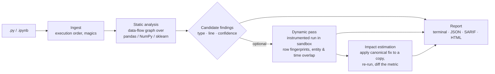

<div align="center">

# LeakLens

**Find the line of ML code that lets test data into training, and measure how much it inflates your score.**

[](https://github.com/bytes06runner/LeakLens/actions/workflows/ci.yml)


[The problem](#the-problem) ·
[What is different](#what-leaklens-does-that-existing-tools-do-not) ·
[Leakage types](#the-six-leakage-types) ·
[How it works](#how-it-works) ·
[Status](#project-status) ·
[Phase 0 results](#phase-0-results-what-exists-today) ·
[Development](#development) ·
[Integrity rules](#research-integrity)

</div>

> [!IMPORTANT]
> LeakLens is a research prototype at **Phase 0 (setup and novelty check)**. The detector is not built yet:
> `leaklens scan` exits with code 3 and says so rather than reporting a file as clean.
> Every number on this page comes from a logged run in [`results/`](results/) or a source in
> [`literature/related_work.csv`](literature/related_work.csv).

---

## The problem

A machine-learning score only means something if the model never saw the test data during training.
**Data leakage** is any path by which evaluation data influences training. The code runs, the tests pass,
and the score looks excellent.

It is common and it is costly:

- Leakage was found in **294 papers across 17 scientific fields**; in a civil-war prediction case study, complex
  models lost their advantage over logistic regression once leakage was fixed
  ([Kapoor & Narayanan, *Patterns* 2023](https://doi.org/10.1016/j.patter.2023.100804)).
- A static analysis of **107,603** public GitHub notebooks flagged at least one leak in **29.6%** of them
  ([Yang et al., ASE 2022](https://doi.org/10.1145/3551349.3556918)).
- In translational EEG, only **17 of 63** surveyed deep-learning studies unambiguously avoided splitting one
  subject's segments across train and test; in one experiment, accuracy fell from **99.8%** to **53.0%**
  (chance) when subjects were held out properly
  ([Brookshire et al., *Front. Neurosci.* 2024](https://doi.org/10.3389/fnins.2024.1373515)).
- Across 2,047 tabular datasets, fitting a scaler on all data changed AUC by **at most 0.005** in all nine
  conditions tested, while boundary (group/temporal) leakage was invisible under random cross-validation
  ([Roth 2026](https://arxiv.org/abs/2604.04199)).

That last point is the core issue. **Code-level tools look for the least harmful kind of leak and cannot see the
most harmful kinds.**

## What LeakLens does that existing tools do not

The table summarises our Phase 0 survey (details and sources: [`docs/PHASE0_REPORT.md`](docs/PHASE0_REPORT.md)).
"Code" means the tool reads your `.py` / `.ipynb` source; "data" means you must export the train and test tables
yourself and hand them over.

| Capability | Code-level analysers<br><sub>Yang et al., NBLyzer, LeakageDetector, LeakCheck</sub> | Data-level checkers<br><sub>Deepchecks, leakcheck-ml, LeakHound, dataleaks</sub> | **LeakLens (goal)** |
|---|:-:|:-:|:-:|
| Points to the line of code responsible | ✅ | ❌ | ✅ |
| Preprocessing / overlap / multi-test leakage | ✅ | partial | ✅ |
| **Group leakage** (same patient/user/device on both sides) | ❌ | ✅ once you export splits | ✅ **from code** |
| **Temporal leakage** (training on the future) | ❌ | ✅ once you export splits | ✅ **from code** |
| Works on cross-validation, not only a single split | n/a | ❌ | ✅ per fold |
| No need to name the group or time column | n/a | leakcheck-ml only | ✅ heuristic, with confidence |
| **Impact estimate** | ❌ | LeakHound: its own proxy model | ✅ **re-runs your pipeline** with the fix |

**The novel parts, stated precisely:**

1. **C1. Group and temporal leakage detected from source code.** No code-level tool we could find does this.
2. **C2. Static findings confirmed on real data without user setup.** The static pass nominates the split call and
   the candidate entity or time column; an instrumented run checks overlap at that call, fold by fold.
3. **C3. Per-finding impact on your own pipeline.** LeakLens applies the canonical fix (for example
   `train_test_split` → `GroupShuffleSplit` on the detected column) to a sandboxed copy, re-runs it, and reports
   the change in the metric your notebook prints. On injected benchmarks the true inflation is known, so we can
   measure how accurate these estimates are and compare them with LeakHound's proxy-model estimate.
4. **C4. A labelled benchmark that includes group and temporal leakage**, which no public dataset has.

## The six leakage types

Full definitions, positive and negative examples, and the mapping to Kapoor & Narayanan's eight types and Yang et
al.'s three arrive in Phase 1 (`docs/TAXONOMY.md`).

| Type | Typical code | Static signal | Dynamic confirmation | Canonical fix |
|---|---|---|---|---|
| **Preprocessing** | `StandardScaler().fit_transform(X)` before the split | fit on data that later reaches the test set | transformer statistics include test rows | split first, or use a `Pipeline` |
| **Overlap / duplicates** | `SMOTE` or augmentation before the split | resampling or concatenation before the split | row fingerprints in both splits | resample inside the training fold |
| **Multi-test** | tuning hyper-parameters against `X_test` | test set used in more than one selection step | same test rows scored for several candidates | hold out a validation set |
| **Group** | random split of EEG windows from the same patient | random splitter + candidate entity column | same entity on both sides | `GroupKFold` / `GroupShuffleSplit` |
| **Temporal** | `shuffle=True` on a time series; lag features before the split | shuffled split + datetime/ordered column | max(train time) > min(test time) | `TimeSeriesSplit`, features after the split |
| **Target-derived** (heuristic) | a feature computed from the label | label or post-outcome column in features | very high single-feature score | remove the feature (flag only, low severity) |

## How it works



- **Static only** (fast, safe, CI-friendly): parses code, never runs it.
- **Static + dynamic**: runs the notebook in an isolated environment to confirm or refute each finding.
- **Impact**: re-runs a fixed copy. If the fix changes more than the leak (for example the model), the estimate is
  marked unreliable. A fix that fails to run is reported as "impact unknown", never dropped.

Each finding will carry: file, line range, type, confidence, evidence, suggested fix, and (when measured) the
metric before and after the fix. The exact schema and CI exit codes are specified in Phase 1 (`docs/SPEC.md`).

## Project status

| Phase | Deliverable | Status |
|---|---|---|
| 0 | Setup, novelty check, baseline runnability | ✅ done, awaiting sign-off ([report](docs/PHASE0_REPORT.md)) |
| 1 | Taxonomy and specification | ⏳ |
| 2 | Benchmark (injected + real, DEV/TEST split frozen before rules) | ⏳ |
| 3 | Evaluation protocol, frozen | ⏳ |
| 4 | Static analyser | ⏳ |
| 5 | Dynamic analyser | ⏳ |
| 6 | Impact estimation | ⏳ |
| 7 | Evaluation on TEST, CalibraEEG case study, ablations | ⏳ |
| 8 | Mining study of public notebooks | ⏳ |
| 9 | Release: PyPI, pre-commit hook, GitHub Action, SARIF | ⏳ |

### Research questions

- **RQ1.** Can group and temporal leakage be detected from ML code, and with what precision and recall per type?
- **RQ2.** How much do detected leaks inflate reported metrics in real notebooks, and how accurate are
  re-execution estimates compared with proxy-model estimates?
- **RQ3.** How common is each leakage type in public notebooks, and does prevalence line up with severity?

## Phase 0 results: what exists today

We wrote four tiny probe scripts with known ground truth ([`baselines/probes`](baselines/probes)) and ran every
tool we could install on them. These probes only test that tools run; they are **not** a benchmark and say nothing
about precision or recall.

| Tool | Reads | Preprocessing probe | Group probe | Temporal probe | Clean probe |
|---|---|:-:|:-:|:-:|:-:|
| Yang et al. analyser (ASE 2022) | code | ✅ flagged | ❌ silent | ❌ silent | ✅ silent |
| leakcheck-ml 0.3.0 | data | – | ✅ no hint needed | ⚠️ warning without hint | – |
| LeakHound 0.5.0 | data | – | only with column named | only with column named; proxy impact +0.042 AUC | – |
| dataleaks 0.1.2 | data | – | ✅ | ❌ | – |
| Deepchecks 0.19.1 | data | – | ❌ (no group check) | only with datetime declared | – |

Other findings:

- Yang et al.'s analyser still builds as released, but only on Linux (Souffle, a pyright fork, Python 3.8). We
  build it in a Kaggle job in about 3 minutes.
- Deepchecks (last release December 2024) fails on a current Python 3.12 stack and needs a pinned Python 3.11 one.
- Five data-level leakage tools were first published in September 2026. We will repeat the novelty search at
  every phase boundary.

## Development

Requires [uv](https://docs.astral.sh/uv/). Python 3.12 is installed by uv if missing.

```bash
git clone https://github.com/bytes06runner/LeakLens.git
cd LeakLens
uv sync                 # creates .venv from uv.lock
uv run pytest           # tests
uv run ruff check .     # lint
uv run leaklens info    # version, types, build status
```

Core libraries are pinned to the versions preinstalled on Kaggle CPU sessions (numpy 2.0.2, pandas 2.3.3,
scikit-learn 1.6.1, scipy 1.16.3), so the same code runs locally and in Kaggle jobs without reinstalling.

### Reproducing Phase 0

```bash
# Data-level baselines (each tool in its own throwaway venv; Deepchecks needs Python 3.11, see baselines/)
uv run python baselines/data_level/make_splits.py /tmp/splits
/path/to/tool-venv/bin/python baselines/data_level/run_tool.py leakcheck-ml /tmp/splits

# Kaggle jobs (needs your own Kaggle credentials in ~/.kaggle)
scripts/kaggle_push.sh kaggle/00_smoke_offline
scripts/kaggle_push.sh kaggle/00b_yang_baseline
```

See [`kaggle/README.md`](kaggle/README.md) for the step-by-step Kaggle workflow.

## Repository layout

```
src/leaklens/        package: ingest/ static/ dynamic/ impact/ report/ cli.py
tests/               pytest (+ hypothesis from Phase 4)
baselines/           runners and probes for existing tools
benchmark/           manifests, labels, injection scripts (Phase 2; no raw code unless licensed)
mining/              corpus sampling and Kaggle jobs (Phase 8)
kaggle/              one folder per Kaggle job + beginner guide
literature/          related_work.csv, every entry marked verified / partial / unverified
results/             one folder per run, never overwritten; registry.csv maps runs to commits
docs/                phase reports, taxonomy, spec
integrations/        pre-commit hook and GitHub Action (Phase 9)
CLAUDE.md            build instructions and integrity rules for the AI pair-programmer
EVAL_CHANGES.md      any rule change made after seeing TEST results
```

## Research integrity

The full rules are in [`CLAUDE.md`](CLAUDE.md#2-integrity-rules-non-negotiable). In short:

- **No fabricated numbers or citations.** Literature claims live in `related_work.csv` with a `verified` column.
- **The detector does not label its own benchmark.** Labels come from injected leaks with known ground truth and
  from two human labellers (Cohen's kappa reported).
- **TEST is frozen before any rule is written** and scored once per release; later changes go in
  `EVAL_CHANGES.md`.
- **Baselines run as released.** Inputs a tool cannot handle count as a coverage result.
- **Per-type precision and recall with confidence intervals**, never a single headline F1.
- **Untrusted notebooks never run on a personal machine**: only in Kaggle sessions with internet off and a scrubbed
  environment.
- **No shaming.** Mining results are aggregates; no notebook author is named.
- **Bad results are reported**, including types where a baseline wins.

## Related work

Twenty-five entries with verification status are in
[`literature/related_work.csv`](literature/related_work.csv). Key references: Kaufman et al. (TKDD 2012),
Kapoor & Narayanan (Patterns 2023), Yang et al. (ASE 2022), Subotić et al. (ICSE-SEIP 2022, SOAP 2022),
Drobnjaković et al. (TASE 2024), Draoui et al. (PACMSE 2026), Roth (arXiv 2026), Grafberger et al. (mlwhatif,
SIGMOD 2023), Schelter et al. (ArgusEyes, SIGMOD 2023), Brookshire et al. (Front. Neurosci. 2024).

## About

LeakLens is a Semester V Software Engineering minor project by **Srijeet Prasad Banerjee** (B.Tech IT), supervised
by **Prof. Tridib Chakraborty**, Guru Nanak Institute of Technology, Kolkata. Companion project:
CalibraEEG (cross-patient seizure detection), whose evaluation regimes provide a ground-truth case study in
Phase 7.

**Licence:** not chosen yet. Until one is added, all rights are reserved.
