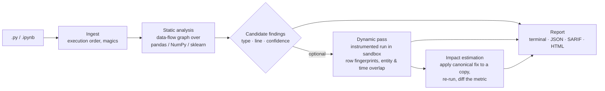

<div align="center">

# LeakLens

**Find the line of ML code that lets test data into training, and measure how much it inflates your score.**

[](https://github.com/bytes06runner/LeakLens/actions/workflows/ci.yml)


[](LICENSE)

[The problem](#the-problem) ·
[What is different](#what-leaklens-does-that-existing-tools-do-not) ·
[Leakage types](#the-six-leakage-types) ·
[How it works](#how-it-works) ·
[Results so far](#results-so-far) ·
[Status](#project-status) ·
[Phase 0 results](#phase-0-results-what-exists-today) ·
[Development](#development) ·
[Integrity rules](#research-integrity)

</div>

> [!IMPORTANT]
> LeakLens is a research prototype. The static analyser, the dynamic (instrumented-run) pass and impact estimation
> are implemented and tested. Results exist for the project's own **injected benchmark** only: the held-out TEST
> half was scored once on 2026-11-12 after the [evaluation protocol](EVAL_PROTOCOL.md) was frozen. **There is no
> result on real notebooks** (none has been labelled), and the benchmark and the tool have the same author. Read
> [`LIMITATIONS.md`](LIMITATIONS.md) first. Every number comes from a logged run in [`results/`](results/) or a
> source in [`literature/related_work.csv`](literature/related_work.csv).

> [!WARNING]
> **Name clash.** An unrelated package called `leaklens` has been on PyPI since June 2026 (data-level checks, a
> different author). This project is not that package and has not been published anywhere. The name is an open
> decision ([`docs/NOVELTY_LOG.md`](docs/NOVELTY_LOG.md)).

---

## The problem

A machine-learning score only means something if the model never saw the test data during training.
**Data leakage** is any path by which evaluation data influences training. The code runs, the tests pass,
and the score looks excellent.

It is common and it is costly:

- Leakage was found in **294 papers across 17 scientific fields**; in a civil-war prediction case study, complex
  models lost their advantage over logistic regression once leakage was fixed
  ([Kapoor & Narayanan, *Patterns* 2023](https://doi.org/10.1016/j.patter.2023.100804)).
- A static analysis of **107,603** public GitHub notebooks flagged at least one leak in **29.6%** of them
  ([Yang et al., ASE 2022](https://doi.org/10.1145/3551349.3556918)).
- In translational EEG, only **17 of 63** surveyed deep-learning studies unambiguously avoided splitting one
  subject's segments across train and test; in one experiment, accuracy fell from **99.8%** to **53.0%**
  (chance) when subjects were held out properly
  ([Brookshire et al., *Front. Neurosci.* 2024](https://doi.org/10.3389/fnins.2024.1373515)).
- Across 2,047 tabular datasets, fitting a scaler on all data changed AUC by **at most 0.005** in all nine
  conditions tested, while boundary (group/temporal) leakage was invisible under random cross-validation
  ([Roth 2026](https://arxiv.org/abs/2604.04199)).

That last point is the core issue. **Code-level tools look for the least harmful kind of leak and cannot see the
most harmful kinds.**

## What LeakLens does that existing tools do not

The table summarises our Phase 0 survey (details and sources: [`docs/PHASE0_REPORT.md`](docs/PHASE0_REPORT.md)).
"Code" means the tool reads your `.py` / `.ipynb` source; "data" means you must export the train and test tables
yourself and hand them over.

| Capability | Code-level analysers<br><sub>Yang et al., NBLyzer, LeakageDetector, LeakCheck, scicode-lint</sub> | Data-level checkers<br><sub>Deepchecks, leakcheck-ml, LeakHound, dataleaks, leaklens (PyPI)</sub> | **LeakLens (implemented; evaluated on its own injected benchmark only)** |
|---|:-:|:-:|:-:|
| Points to the line of code responsible | ✅ | ❌ | ✅ |
| Preprocessing / overlap / multi-test leakage | ✅ | partial | ✅ |
| **Group leakage** (same patient/user/device on both sides) | ❌ static; splitguard: at runtime if you declare the group ids | ✅ once you export splits | ✅ **from code, entity inferred (primary novelty)** |
| **Temporal leakage** (training on the future) | partial: scicode-lint (LLM patterns: shuffled CV, forward shifts) | ✅ once you export splits | ✅ from code, via data flow, confirmed on data |
| Works on cross-validation, not only a single split | n/a | ❌ | ✅ per fold |
| No need to name the group or time column | n/a | leakcheck-ml only | ✅ heuristic, with confidence |
| **Impact estimate** | ❌ | LeakHound: its own proxy model | ✅ **re-runs your pipeline** with the fix (six kinds of fix so far) |

This table compares capabilities, read from each tool's paper or documentation. It does not compare accuracy.
Leakly (2026) re-runs a user's pipeline on shuffled labels to test for leakage in general; it does not locate a leak
or apply a fix.

**The novel parts, stated precisely:**

1. **C1. Group leakage detected from source code**, the primary novelty: no static tool we could find detects it,
   and the one runtime tool that does (splitguard, 2026) needs the user to declare the group ids. LeakLens infers
   the entity from names, repetition and file paths. Temporal leakage is detected by data-flow analysis and confirmed on the data; this improves on existing
   code-level checks (scicode-lint, 2026, asks an LLM about shuffled CV and forward-looking features) rather than
   being a first. The benchmark has a separate category for the cases where the two approaches differ, such as
   `train_test_split`'s default shuffle on time-ordered data (see [`docs/NOVELTY_LOG.md`](docs/NOVELTY_LOG.md)).
2. **C2. Static findings confirmed on real data without user setup.** The static pass nominates the split call and
   the candidate entity or time column; an instrumented run checks overlap at that call, fold by fold.
3. **C3. Per-finding impact on your own pipeline.** LeakLens applies the canonical fix (for example
   `train_test_split` → `GroupShuffleSplit` on the detected column) to a sandboxed copy, re-runs it, and reports
   the change in the metric your notebook prints. On injected benchmarks the true inflation is known, so we can
   measure how accurate these estimates are and compare them with LeakHound's proxy-model estimate.
4. **C4. A labelled benchmark that includes group and temporal leakage**, which no public dataset has.

## The six leakage types

Full definitions, runnable positive and negative examples, and the mapping to Kapoor & Narayanan's eight types and
Yang et al.'s three are in [`docs/TAXONOMY.md`](docs/TAXONOMY.md).

| Type | Typical code | Static signal | Dynamic confirmation | Canonical fix |
|---|---|---|---|---|
| **Preprocessing** | `StandardScaler().fit_transform(X)` before the split | fit on data that later reaches the test set | transformer statistics include test rows | split first, or use a `Pipeline` |
| **Overlap / duplicates** | `SMOTE` or augmentation before the split | resampling or concatenation before the split | row fingerprints in both splits | resample inside the training fold |
| **Multi-test** | tuning hyper-parameters against `X_test` | test set used in more than one selection step | same test rows scored for several candidates | hold out a validation set |
| **Group** | random split of EEG windows from the same patient | random splitter + candidate entity column | same entity on both sides | `GroupKFold` / `GroupShuffleSplit` |
| **Temporal** | `shuffle=True` on a time series; lag features before the split | shuffled split + datetime/ordered column | max(train time) > min(test time) | `TimeSeriesSplit`, features after the split |
| **Target-derived** (heuristic) | a feature computed from the label | label or post-outcome column in features | very high single-feature score | remove the feature (flag only, low severity) |

## How it works



- **Static only** (fast, safe, CI-friendly): parses code, never runs it.
- **Static + dynamic**: runs the notebook in an isolated environment to confirm or refute each finding.
- **Impact**: re-runs a fixed copy. If the fix changes more than the leak (for example the model), the estimate is
  marked unreliable. A fix that fails to run is reported as "impact unknown", never dropped.

Each finding carries: file, line range, type, confidence, evidence, suggested fix, and (when measured) the
metric before and after the fix. The format, severity levels and CI exit codes are specified in
[`docs/SPEC.md`](docs/SPEC.md), with a machine-readable
[JSON Schema](src/leaklens/report/finding.schema.json).

### Running untrusted notebooks safely

Dynamic and impact modes execute code. Notebooks from the internet run only through
[`leaklens.sandbox`](src/leaklens/sandbox.py), inside an offline Kaggle session: the child process gets an
allow-listed environment, a throwaway working directory, a process-group timeout, and runs as an unprivileged
user. Each layer answers a measured problem. Kaggle injects session tokens into every notebook, even offline, and
the data proxy `dp.kaggle.net` stays reachable. A child running as root could read those tokens from
`/proc/<pid>/environ` even with a clean environment. The sandbox refuses to run untrusted code anywhere it cannot
drop privileges or while the network is reachable. Evidence:
[`results/`](results/) (`00_smoke_offline`, `01b_sandbox_hardening_probe`, `01_sandbox_check`).

## Results so far

### Held-out TEST split, scored once

Run: [`results/2026-11-12_test_injected_leaklens_v1`](results/2026-11-12_test_injected_leaklens_v1), at the
commit that froze the protocol. Tool: LeakLens. Split: **TEST** of the injected benchmark: 79 files from 6 base
pipelines that were not used for development, 73 labelled leaks, 9 files with no leak. Findings of medium or high
confidence; a finding counts only with the right type on overlapping lines in the right cell.

| Leakage type | Labelled leaks | Static: found | Static: recall (95% CI) | Static + dynamic: found | Static + dynamic: recall (95% CI) | False positives (either mode) |
|---|---|---|---|---|---|---|
| Preprocessing | 22 | 21 | 0.95 (0.84 to 1.00) | 21 | 0.95 (0.84 to 1.00) | 0 |
| Overlap / duplicates | 9 | 7 | 0.78 (0.44 to 1.00) | 9 | 1.00 (1.00 to 1.00) | 0 |
| Multi-test | 6 | 5 | 0.83 (0.43 to 1.00) | 5 | 0.83 (0.43 to 1.00) | 0 |
| Group (entity) | 7 | 3 | 0.43 (0.00 to 0.83) | 7, of which 3 name the right column | 1.00 by the matching rule; 0.43 strictly | 0 |
| Temporal | 25 | 20 | 0.80 (0.62 to 0.95) | 20 | 0.80 (0.62 to 0.95) | 0 |
| Target-derived | 4 | 3 | 0.75 (0.00 to 1.00) | 3 | 0.75 (0.00 to 1.00) | 0 |
| **All types** | 73 | 59 | 0.81 | 65 | 0.89 | 0 |

No finding on any of the 9 leak-free files. What this does and does not show:

- **It is a held-out result on synthetic files.** The rules were never tuned on these files, but the files come
  from this project's own leak generator and are short. Precision 1.00 will not hold on real code.
- **Group leakage: right line, wrong column in 4 of 7.** The static pass guessed a column called `visit` at low
  confidence; the run "confirmed" it (visit numbers always repeat across a split) and never looked at
  `patient_id`. The matching rule checks type and line only, so the table says 7; strictly it is 3.
- **Eight leaks missed**, from two causes: a slice that drops the last row (`data.iloc[:-1]`) was mistaken for a
  train/test split (five temporal leaks reported only at low confidence, one multi-test leak missed), and a
  feature list built with a `startswith` filter could not be resolved (one target-encoding leak and one
  target-derived feature missed). None of this has been fixed: a fix followed by a re-run would be a second look
  at TEST ([`EVAL_CHANGES.md`](EVAL_CHANGES.md) #7).
- **Impact estimates on TEST** ([report](results/2026-11-12_test_injected_leaklens_v1/IMPACT_REPORT.md)): an
  estimate for 34 of 70 located leaks. On 26 single-leak findings with a bounded metric, averaged over five data
  seeds: mean absolute error 0.035, rank correlation 0.58. Exact where the fix is the same operation as the
  benchmark's corrected file; **wrong direction for hold-out group splits** (the wrong-column fault above).
  Injected inflation is by construction and is not evidence of real-world severity.

Full account: [`docs/PHASE7_TEST_REPORT.md`](docs/PHASE7_TEST_REPORT.md).

### One measured baseline: Yang et al. (ASE 2022) on the same TEST files

The reference static analyser was built from source and run with its default command on the 79 TEST files
([run](results/2026-11-12_kaggle_05_yang_test_injected), [details](docs/PHASE7_TEST_REPORT.md)). It reports the
affected evaluation line, not the leaking line, so both tools are scored **per file and type** here (a looser
rule than the one above, logged in `EVAL_CHANGES.md` #6). LeakLens is in static mode, like the baseline.

| Leakage type | Files with this leak | Yang et al.: files found | Yang: false alarms | LeakLens (static): files found | LeakLens: false alarms |
|---|---|---|---|---|---|
| Preprocessing | 22 | 10 | 1 | 21 | 0 |
| Overlap / duplicates | 9 | 7 | 0 | 7 | 0 |
| Multi-test | 6 | 3 | 0 | 5 | 0 |
| Group (entity) | 7 | 0 (not a type it claims) | 0 | 3 | 0 |
| Temporal | 24 | 3 (not a type it claims) | 0 | 19 | 0 |
| Target-derived | 4 | 0 (not a type it claims) | 0 | 3 | 0 |

Neither tool was tuned on these files. They are still files generated by this project, with the kinds of
leak LeakLens was built for, in a style that may differ from the notebooks the Yang analyser was designed on,
so the comparison favours LeakLens. The numbers its authors report on their own data (precision 97.6%, recall
67.8%) are a different measurement and cannot be compared with this table. Temporal has 24 files, not 25
leaks, because one file holds two temporal leaks.

### DEV split (the files the rules were written on)

Run: [`results/2026-11-12_dev_injected_leaklens_v2`](results/2026-11-12_dev_injected_leaklens_v2) (laptop, own
generated pipelines only). Tool: LeakLens. Split: **DEV** of the injected benchmark, 96 files,
89 labelled leaks, 10 files with no leak. Findings of medium or high confidence; a finding counts only
with the right type on overlapping lines in the right cell ([protocol](EVAL_PROTOCOL.md)).

| Leakage type | Labelled leaks | Static: found | Static: recall (95% CI) | Static + dynamic: found | Static + dynamic: recall (95% CI) | False positives (either mode) |
|---|---|---|---|---|---|---|
| Preprocessing | 30 | 30 | 1.00 (1.00 to 1.00) | 30 | 1.00 (1.00 to 1.00) | 0 |
| Overlap / duplicates | 10 | 8 | 0.80 (0.50 to 1.00) | 10 | 1.00 (1.00 to 1.00) | 0 |
| Multi-test | 8 | 8 | 1.00 (1.00 to 1.00) | 8 | 1.00 (1.00 to 1.00) | 0 |
| Group (entity) | 10 | 3 | 0.30 (0.00 to 0.62) | 10 | 1.00 (1.00 to 1.00) | 0 |
| Temporal | 25 | 25 | 1.00 (1.00 to 1.00) | 25 | 1.00 (1.00 to 1.00) | 0 |
| Target-derived | 6 | 6 | 1.00 (1.00 to 1.00) | 6 | 1.00 (1.00 to 1.00) | 0 |
| **All types** | 89 | 80 | 0.90 | 89 | 1.00 | 0 |

No finding on any of the 10 files without a leak. **DEV numbers are optimistic by design: the rules were tuned on
these files.** What they do show:

- **Linking the two passes matters for group leakage.** In 7 of the 10 group leaks the entity column is in the
  data and never named in the code, so the static pass cannot see it; the instrumented run finds it in the
  script's own variables, with nothing declared by the user.
- **Static analysis is fast:** median 1.7 ms per file here. The 71 real DEV
  notebooks (unlabelled) were analysed without a crash; what the tool flags there is not a result, because nobody
  has labelled them.
- **Impact estimates** ([report](results/2026-11-12_dev_injected_leaklens_v2/IMPACT_REPORT.md)): an estimate
  could be produced for 41 of 89 found leaks; the rest are reported as "impact unknown" with the
  reason. On the 35 single-leak estimates with a bounded metric, mean absolute error
  against the true inflation is 0.027 and rank correlation 0.96.
  Most errors are zero because the fix is the same operation as the benchmark's own correct version. The exception
  is hold-out group splits with few entities, where the estimate is off by about 0.30 AUC: the direction is right,
  the size is not reliable. Injected inflation is by construction and is not evidence of real-world severity.

**Negative results so far.** On the companion project CalibraEEG the static analyser found nothing in any of the
three evaluation regimes: correct for the leave-one-patient-out regime, a miss for the two leaky ones, because that
code splits with hand-written NumPy masks over custom objects rather than scikit-learn splitters. Details: [`docs/PHASE3_6_REPORT.md`](docs/PHASE3_6_REPORT.md).

### Try it

```bash
uv run leaklens scan path/to/notebook.ipynb            # static: reads the code, runs nothing
uv run leaklens scan src/ --format sarif -o leaklens.sarif --fail-on high
uv run leaklens scan my_pipeline.py --dynamic --impact --trust-code   # runs YOUR code, instrumented
```

`--dynamic` and `--impact` execute the file, so they require `--trust-code`. Never use them on notebooks from the
internet outside the sandbox described below.

## Project status

| Phase | Deliverable | Status |
|---|---|---|
| 0 | Setup, novelty check, baseline runnability | ✅ done ([report](docs/PHASE0_REPORT.md)) |
| 1 | Taxonomy, specification, sandbox | ✅ done ([report](docs/PHASE1_REPORT.md)) |
| 2 | Benchmark (injected + real, DEV/TEST split frozen before rules) | 🔄 injected done; real notebooks sampled, **not labelled** |
| 3 | Evaluation protocol | ✅ [frozen](EVAL_PROTOCOL.md), version 1.0, 2026-11-12 |
| 4 | Static analyser | ✅ built |
| 5 | Dynamic analyser | ✅ built |
| 6 | Impact estimation | 🔄 built for six kinds of fix; about half of the leaks have no automatic fix yet |
| 7 | Evaluation on TEST, baselines, CalibraEEG case study, ablations | 🔄 injected TEST scored once; Yang et al. baseline run; case study negative; real set and other baselines pending |
| 8 | Mining study of public notebooks | ⏳ |
| 9 | Release: PyPI, pre-commit hook, GitHub Action, SARIF | 🔄 CLI, JSON and SARIF done; packaging not started; name clash to resolve |

### Research questions

- **RQ1.** Can group and temporal leakage be detected from ML code, and with what precision and recall per type?
- **RQ2.** How much do detected leaks inflate reported metrics in real notebooks, and how accurate are
  re-execution estimates compared with proxy-model estimates?
- **RQ3.** How common is each leakage type in public notebooks, and does prevalence line up with severity?

## Phase 0 results: what exists today

We wrote four tiny probe scripts with known ground truth ([`baselines/probes`](baselines/probes)) and ran every
tool we could install on them. These probes only test that tools run; they are **not** a benchmark and say nothing
about precision or recall.

| Tool | Reads | Preprocessing probe | Group probe | Temporal probe | Clean probe |
|---|---|:-:|:-:|:-:|:-:|
| Yang et al. analyser (ASE 2022) | code | ✅ flagged | ❌ silent | ❌ silent | ✅ silent |
| leakcheck-ml 0.3.0 | data | – | ✅ no hint needed | ⚠️ warning without hint | – |
| LeakHound 0.5.0 | data | – | only with column named | only with column named; proxy impact +0.042 AUC | – |
| dataleaks 0.1.2 | data | – | ✅ | ❌ | – |
| Deepchecks 0.19.1 | data | – | ❌ (no group check) | only with datetime declared | – |

Other findings:

- Yang et al.'s analyser still builds as released, but only on Linux (Souffle, a pyright fork, Python 3.8). We
  build it in a Kaggle job in about 3 minutes.
- Deepchecks (last release December 2024) fails on a current Python 3.12 stack and needs a pinned Python 3.11 one.
- Five data-level leakage tools were first published in September 2026. The novelty search is repeated at every
  phase boundary ([`docs/NOVELTY_LOG.md`](docs/NOVELTY_LOG.md)); the Phase 1 search found scicode-lint, which
  covers part of temporal leakage from code.
- Excluded or deferred baselines and the reasons are in [`docs/EXCLUDED_BASELINES.md`](docs/EXCLUDED_BASELINES.md):
  ReproGuard (its licence forbids use for competing tools) and LeakCheck (needs a paid LLM API; deferred).

## Development

Requires [uv](https://docs.astral.sh/uv/). Python 3.12 is installed by uv if missing.

```bash
git clone https://github.com/bytes06runner/LeakLens.git
cd LeakLens
uv sync                 # creates .venv from uv.lock
uv run pytest           # tests
uv run ruff check .     # lint
uv run leaklens info    # version, types, build status
```

Core libraries are pinned to the versions preinstalled on Kaggle CPU sessions (numpy 2.0.2, pandas 2.3.3,
scikit-learn 1.6.1, scipy 1.16.3), so the same code runs locally and in Kaggle jobs without reinstalling.

### Reproducing Phase 0

```bash
# Data-level baselines (each tool in its own throwaway venv; Deepchecks needs Python 3.11, see baselines/)
uv run python baselines/data_level/make_splits.py /tmp/splits
/path/to/tool-venv/bin/python baselines/data_level/run_tool.py leakcheck-ml /tmp/splits

# Kaggle jobs (needs your own Kaggle credentials in ~/.kaggle)
scripts/kaggle_push.sh kaggle/00_smoke_offline
scripts/kaggle_push.sh kaggle/00b_yang_baseline
```

See [`kaggle/README.md`](kaggle/README.md) for the step-by-step Kaggle workflow.

## Repository layout

```
src/leaklens/        package: ingest/ static/ dynamic/ impact/ report/ sandbox.py cli.py
configs/             YAML settings (no magic numbers in code)
tests/               pytest; fixtures/taxonomy/ holds the runnable TAXONOMY examples
baselines/           runners and probes for existing tools
benchmark/           manifests, labels, injection scripts (Phase 2; no raw code unless licensed)
mining/              corpus sampling and Kaggle jobs (Phase 8)
kaggle/              one folder per Kaggle job + beginner guide
literature/          related_work.csv, every entry marked verified / partial / unverified
results/             one folder per run, never overwritten; registry.csv maps runs to commits
docs/                phase reports, taxonomy, spec
integrations/        pre-commit hook and GitHub Action (Phase 9)
CLAUDE.md            build instructions and integrity rules for the AI pair-programmer
EVAL_PROTOCOL.md     evaluation protocol (frozen, version 1.0)
EVAL_CHANGES.md      what was seen and changed, and when
LIMITATIONS.md       what the tool and the results cannot do
```

## Research integrity

The full rules are in [`CLAUDE.md`](CLAUDE.md#2-integrity-rules-non-negotiable). In short:

- **No fabricated numbers or citations.** Literature claims live in `related_work.csv` with a `verified` column.
- **The detector does not label its own benchmark.** Labels come from injected leaks with known ground truth and
  from two human labellers (Cohen's kappa reported).
- **TEST is frozen before any rule is written** and scored once per release; later changes go in
  `EVAL_CHANGES.md`.
- **Baselines run as released.** Inputs a tool cannot handle count as a coverage result.
- **Per-type precision and recall with confidence intervals**, never a single headline F1.
- **Untrusted notebooks never run on a personal machine**: only in Kaggle sessions with internet off and a scrubbed
  environment.
- **No shaming.** Mining results are aggregates; no notebook author is named.
- **Bad results are reported**, including types where a baseline wins.
- **No code from other tools.** Baselines run in their own environments; nothing from them is copied into
  LeakLens.

## Related work

Thirty-seven entries with verification status are in
[`literature/related_work.csv`](literature/related_work.csv). Key references: Kaufman et al. (TKDD 2012),
Kapoor & Narayanan (Patterns 2023), Yang et al. (ASE 2022), Subotić et al. (ICSE-SEIP 2022, SOAP 2022),
Drobnjaković et al. (TASE 2024), Draoui et al. (PACMSE 2026), Roth (arXiv 2026), Grafberger et al. (mlwhatif,
SIGMOD 2023), Schelter et al. (ArgusEyes, SIGMOD 2023), Brookshire et al. (Front. Neurosci. 2024).

## About

LeakLens is a Semester V Software Engineering minor project by **Srijeet Prasad Banerjee** (B.Tech IT), supervised
by **Prof. Tridib Chakraborty**, Guru Nanak Institute of Technology, Kolkata. Companion project:
CalibraEEG (cross-patient seizure detection), whose evaluation regimes provide a ground-truth case study in
Phase 7.

**Licence:** [MIT](LICENSE).
